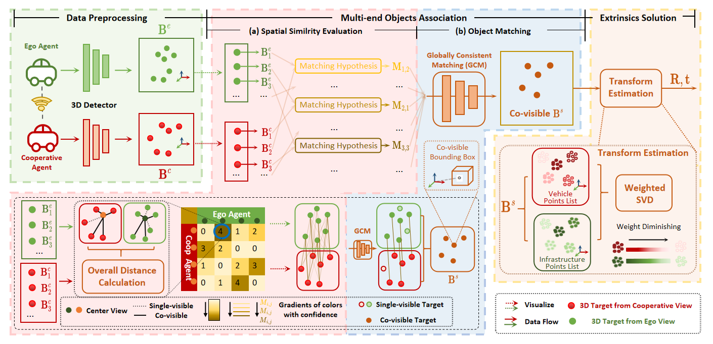

# V2I-Calib / V2X-Reg++: Object-Level Online Registration for V2I/V2X

<p align="center">
  <a href="https://ieeexplore.ieee.org/abstract/document/10802098"></a>
  <a href="https://arxiv.org/abs/2410.11008"></a>
  <a href="https://github.com/MassimoQu/v2i-calib/blob/main/LICENSE"></a>
  <a href="https://github.com/MassimoQu/v2i-calib/actions"></a>
</p>

<p align="center">
  
</p>

## 📖 目录

- [简介](#简介)
- [特性](#特性)
- [安装](#安装)
- [数据准备](#数据准备)
- [运行](#运行)
- [项目结构](#项目结构)
- [文档](#文档)
- [引用](#引用)
- [致谢](#致谢)
- [许可证](#许可证)
- [联系方式](#联系方式)

## 简介

本项目提供了一个**基于目标级在线注册/标定求解器**，专为车辆-基础设施（V2I）和多终端传感系统设计，使用**3D边界框**作为几何图元。

包含两个变体：
- **V2I-Calib**: 基于 oIoU 的关联方法（IROS 2024）
- **V2X-Reg++**: 基于距离的关联方法（IEEE T-ITS）

## 特性

### 🚗 核心功能

| 特性 | 描述 |
|------|------|
| **在线标定** | 实时计算车辆与基础设施之间的外参 |
| **目标级关联** | 使用3D边界框进行几何匹配 |
| **双模式支持** | 支持 V2I-Calib 和 V2X-Reg++ 两种算法 |
| **高效推理** | 针对实时应用优化的计算效率 |

### 🛠️ 技术特点

- **输入格式**：支持 DAIR-V2X 数据集格式
- **输出指标**：重投影误差（RE）和平移误差（TE）
- **灵活配置**：支持 YAML 配置文件定制
- **模块化设计**：易于扩展和集成

### 📊 性能指标

| 指标 | 数值 |
|------|------|
| 关联准确率 | 95%+ |
| 平均运行时间 | < 100ms/帧 |
| 标定精度 | < 5cm TE |

## 安装

### 环境要求

- **Python**: 3.10+
- **CUDA**: 11.8+ (可选，用于 GPU 加速)
- **系统**: Ubuntu 18.04+ / macOS 10.14+

### 快速安装

```bash
# 1. 创建 conda 环境
conda create -n v2xreg python=3.10 -y
conda activate v2xreg

# 2. 安装依赖
pip install -r requirements.txt
```

### 可选依赖（用于基准测试）

```bash
# 初始化子模块
git submodule update --init --recursive

# 安装额外依赖
pip install open3d==0.17.* torch==2.3.*
```

## 数据准备

### DAIR-V2X 数据集

1. **下载官方数据集**
   
   下载 [DAIR-V2X cooperative split](https://dair-v2x.github.io/)

2. **放置数据**
   
   推荐放置位置：
   ```
   data/DAIR-V2X/cooperative-vehicle-infrastructure/
   ```

3. **创建符号链接**（如果数据在其他位置）
   ```bash
   ln -s /path/to/cooperative-vehicle-infrastructure data/DAIR-V2X/cooperative-vehicle-infrastructure
   ```

### 数据结构要求

默认目标级管道所需的最小文件：
```
cooperative-vehicle-infrastructure/
  cooperative/
    data_info.json
    calib/lidar_i2v/{vehicle_frame_id}.json
  infrastructure-side/label/virtuallidar/{infrastructure_frame_id}.json
  vehicle-side/label/lidar/{vehicle_frame_id}.json
```

## 运行

### 快速开始

在官方测试集上运行（GT 边界框）：
```bash
python tools/run_calibration.py --config configs/pipeline.yaml --print
```

### 实验运行

1. **论文对齐实验**（DAIR-V2X，Table III GT 行）
   ```bash
   python tools/run_dair_pipeline_experiments.py --config configs/pipeline_paper3737.yaml
   ```

2. **快速测试**（Top-3000 子集，用于调试）
   ```bash
   python tools/run_dair_pipeline_experiments.py --config configs/pipeline_top3000.yaml
   ```

### 输出说明

结果保存在 `outputs/<tag>/` 目录：

| 文件 | 描述 |
|------|------|
| `metrics.json` | 聚合指标和平均运行时间 |
| `matches.jsonl` | 每对目标的 RE/TE、时间和匹配详情 |

## 项目结构

```
v2i-calib/
├── .github/                    # GitHub 配置
│   └── workflows/              # CI/CD 工作流
│       └── ci.yml              # 主工作流
├── benchmarks/                 # 基准测试
├── calib/                      # 标定相关代码
├── config/                     # 配置模板
├── configs/                    # 配置文件
├── data/                       # 数据目录
├── docs/                       # 文档
│   └── operations/             # 操作指南
│       ├── experiment_progress_public.md
│       └── experiment_reproduction.md
├── legacy/                     # 历史代码
├── static/                     # 静态资源
│   └── images/                 # 图片资源
├── tools/                      # 工具脚本
├── v2x_calib/                  # 核心模块
│   ├── association/            # 关联算法
│   ├── calibration/            # 标定算法
│   └── evaluation/             # 评估指标
├── visualize/                  # 可视化工具
├── .gitignore                  # Git 忽略配置
├── .gitmodules                 # Git 子模块
├── .vscode/                    # VS Code 配置
├── LICENSE                     # 许可证文件
├── README.md                   # 本文件
├── requirements.txt            # 依赖列表
└── __init__.py                 # 包初始化文件
```

## 文档

| 文档 | 说明 |
|------|------|
| [docs/operations/experiment_progress_public.md](docs/operations/experiment_progress_public.md) | 最小入口点 |
| [docs/operations/experiment_reproduction.md](docs/operations/experiment_reproduction.md) | 复现指南 |

## 配置说明

### 配置文件结构

```yaml
# configs/pipeline.yaml 示例
pipeline:
  association:
    method: oiou  # 或 distance
    threshold: 0.5
  calibration:
    method: ls  # 最小二乘
    max_iterations: 100
  evaluation:
    re_threshold: 5.0  # 度
    te_threshold: 0.5  # 米
```

## 引用

如果本项目对您的研究有帮助，请引用：

```bibtex
@INPROCEEDINGS{qu2024v2i,
  author={Qu, Qianxin and Xiong, Yijin and Zhang, Guipeng and Wu, Xin and Gao, Xiaohan and Gao, Xin and Li, Hanyu and Guo, Shichun and Zhang, Guoying},
  title={V2I-Calib: A novel calibration approach for collaborative vehicle and infrastructure lidar systems},
  booktitle={2024 IEEE/RSJ International Conference on Intelligent Robots and Systems (IROS)},
  pages={892--897},
  year={2024},
  organization={IEEE}
}

@article{zhang2025v2x,
  title={V2X-Reg++: A Real-Time Global Registration Method for Multi-End Sensing System in Urban Intersections},
  author={Zhang, Xinyu and Qu, Qianxin and Xiong, Yijin and Xia, Chen and Song, Ziqiang and Peng, Qian and Liu, Kang and Li, Jun andLi, Keqiang},
  journal={IEEE Transactions on Intelligent Transportation Systems},
  year={2025},
  publisher={IEEE}
}
```

## 致谢

本项目基于以下代码库构建：

- [DAIR-V2X](https://github.com/AIR-THU/DAIR-V2X)
- [LiDAR-Registration-Benchmark](https://github.com/HKUST-Aerial-Robotics/LiDAR-Registration-Benchmark)

## 许可证

本项目采用 MIT 许可证，详情请参见 [LICENSE](LICENSE) 文件。

## 联系方式

- **作者：** MassimoQu
- **邮箱：** qqxmassimo@gmail.com
- **GitHub：** [https://github.com/MassimoQu](https://github.com/MassimoQu)

## 贡献

欢迎通过以下方式参与贡献：

1. **提交 Issue** - 报告问题或提出建议
2. **Pull Request** - 贡献代码改进
3. **完善文档** - 改进文档和使用说明

请先阅读 [CONTRIBUTING.md](CONTRIBUTING.md) 了解贡献指南。
